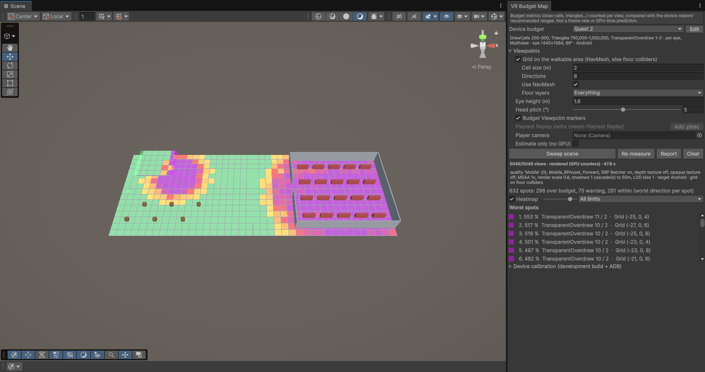
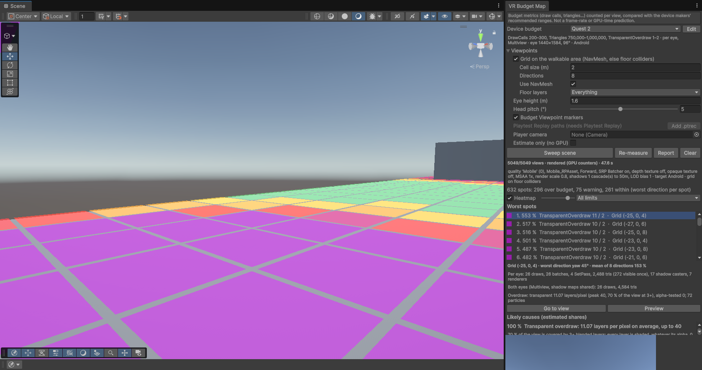
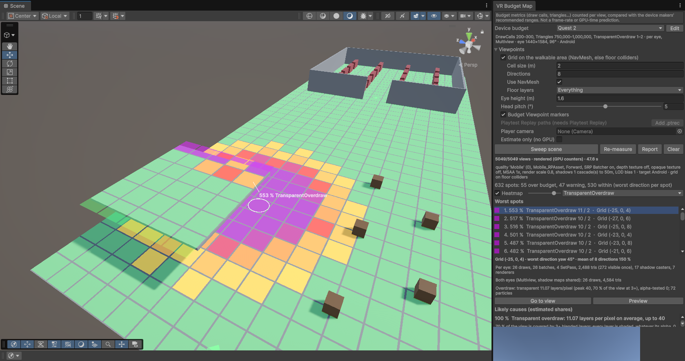

# VR Budget Map for Unity

[Manual](manual/) · [Changelog](changelog/) · [Support](#support)

See where your VR level goes over the draw-call and triangle budget of a standalone headset: a heatmap over the whole
level, the worst spots, and why. In the Editor, before you build.

Unity 2022.3 LTS and Unity 6 · URP 14+ · Editor only, nothing added to your builds · full C# source.

> **Budget metrics, not a frame-rate prediction.** VR Budget Map counts what the GPU is asked to do per view and compares
> it with the ranges the device makers recommend. It does not predict frame rate or GPU time.

## Get started

1. Open `Samples/Scenes/VRBudgetMap_SampleLevel`.
2. **Window ▸ Analysis ▸ VR Budget Map**.
3. Pick a device budget and press **Sweep scene**. About 5,000 views take under a minute on a desktop GPU.
4. Read the heatmap in the Scene view, click a worst spot, read its likely causes, press **Report**.

Full details are in the [manual](manual/). The same manual is included in the package under `Documentation/`.

## Measure

- Thousands of viewpoints: a grid on the NavMesh or floor colliders × 8 directions, markers you place, and real
  playtester paths from Playtest Replay
- Each view rendered offscreen at the headset's eye resolution with the quality level your build uses
- Unity's own counters: draw calls, batches, SetPass calls, triangles, vertices, shadow casters, skinned meshes
- Transparent and alpha-tested overdraw per pixel, particles, without changing your renderer
- Draw calls matched Unity's Frame Debugger in every view of our test scenes (Unity 2022.3 and Unity 6)

## Compare with a budget

- Presets for Quest 2, Quest 3 / 3S, Pico 4 and PC VR with the source of every number next to it; edit them or add your own
- Per-eye or whole-frame budgets; multiview and multi-pass stereo
- Each standing spot is scored by its worst direction: in VR the player can look anywhere

## Fix

- Heatmap in the Scene view and a worst-spot list; click to stand where the player stands and look where it hurts
- Likely causes with the objects to select: shadow casters, extra materials, meshes repeated without instancing, missing
  LODs, pipeline passes (SSAO, depth prepass, opaque texture), transparency, realtime lights, uncompressed textures
- Markdown report and CSV of every view for your team or CI

## Check on the headset

Push the same viewpoints to a development build over ADB and get an editor-vs-device error table for your own project.

## Known limitations

- Unity's baked occlusion culling is not applied to the measured views: behind walls the counts are upper bounds. The
  tool warns when the scene has baked occlusion data.
- Without a GPU (`-nographics`) views are estimated and labelled ESTIMATE.
- See the [manual](manual/#6-limitations) for the full list.

## Support

E-mail: devirosnguyen@gmail.com

When reporting a problem, please include your Unity version, URP version, build target and the Console log.

---

This repository contains documentation only. VR Budget Map is sold on the Unity Asset Store by JieYingStudio.
For Meta Quest, Pico and PC VR projects on URP.
